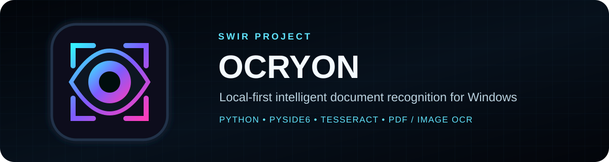

<!-- SWIR-README-STANDARD:v2 -->

<div align="center">



<br>


**Local-first intelligent document recognition for Windows.**

[**Highlights**](#-highlights) · [**Quick Start**](#-quick-start) · [**Roadmap**](#-roadmap) · [**Releases**](#-releases)

</div>

## Project status

| Item | Status |
|---|---|
| Current stage | **0.2.0 — stable Windows release** |
| Source version | `0.2.0` |
| Public test build | `v0.1.0-beta.1` — frozen |
| Roadmap | **22 / 22 = 100%** of the 0.2.0 checklist |
| Verified desktop | Windows 11 25H2 x64, build 26200 |
| License | **GNU AGPL v3 (AGPL-3.0-only)**; full application source supplied |

The frozen `v0.1.0-beta.1` remains the historical public test build. Download the stable installer, portable package and complete application sources from [v0.2.0](https://github.com/Swir/OCRYON/releases/tag/v0.2.0).

## Overview

**OCRYON** is an open-source desktop OCR application focused on private, local conversion of scans, screenshots, photos and PDF pages into editable text.

Recognition is separated from the interface so the OCR pipeline can evolve without coupling it to the Windows GUI. Current development uses a Tesseract backend and keeps document processing local to the machine.

## ⚡ Highlights

| Feature | What it does |
|---|---|
| 👁️ Local OCR | Processes documents on the user's computer instead of requiring a hosted OCR service. |
| 🖼️ Image + PDF import | Loads images and multi-page PDF documents for page-by-page recognition. |
| 🧵 Background recognition | Runs OCR outside the GUI thread to keep the desktop interface responsive. |
| 📚 Batch OCR | Recognizes all loaded pages in one workflow. |
| 🧹 Automatic preprocessing | Applies the current automatic OCR image-preparation pipeline before recognition. |
| ✏️ Editable results | Keeps recognized text editable per page. |
| 📐 Word coordinates | Captures word-level OCR coordinates for layout-aware export paths. |
| 📄 Multiple exports | Supports TXT, DOCX and searchable PDF output. |
| 🌍 Bundled languages | Includes the offline OCR runtime with ENG/PL/NOR models and five language selections. |
| 🪟 Windows packaging | Native Windows EXE, portable ZIP and per-user installer. |
| ⌨️ Accessible controls | Named controls, keyboard shortcuts, focus order and 100%/150%/200% scaling. |
| 🩺 Diagnostics and recovery | Local engine checks, language-file status and retry of the last OCR operation. |

## 🚀 Quick Start

### From source

Use the accompanying qualified source archive. OCRYON requires **Python 3.12 or newer**; the release build uses Python 3.12.14 x64.

```powershell
cd OCRYON-0.2.0-source
py -3.12 -m venv .venv
.\.venv\Scripts\Activate.ps1
python -m pip install -c requirements-windows.lock -e ".[dev]"
ocryon
```

You can also launch the package directly:

```powershell
python -m ocryon
```

### Development OCR backend

Current source builds use Tesseract. Either make `tesseract.exe` available on `PATH` or point OCRYON to a local executable:

```powershell
$env:OCRYON_TESSERACT = "C:\Program Files\Tesseract-OCR\tesseract.exe"
ocryon
```

The portable ZIP and installer include Python, Qt, Tesseract and ENG/PL/NOR data. Extract the complete portable ZIP and run `OCRYON.exe`; keep `_internal` beside it. No separate installation of these dependencies or online OCR service is needed.

To rebuild the portable package on Windows x64, run `python tools/build_on_windows_preview.py`. It verifies pinned OCR downloads, builds the EXE, runs frozen acceptance, and packages the result. Compile `packaging/OCRYON.iss` with Inno Setup for the installer. `tools/native_installer_acceptance.py` tests a fresh isolated install and removes that test installation.

### License and corresponding source

OCRYON is licensed under GNU AGPL version 3; see [LICENSE](LICENSE). Copyright (C) 2026 OCRYON contributors. The program is supplied without warranty. The release includes all application sources, tests and build scripts. [SOURCE-DEPENDENCIES.json](packaging/SOURCE-DEPENDENCIES.json) records verified versioned upstream sources for its unmodified dependencies; [third-party notices](packaging/THIRD-PARTY-NOTICES.txt) describe their licenses. Qt uses replaceable shared libraries.

## Requirements / compatibility

- **Verified OS:** Windows 11 25H2 x64; Windows 10 has not been qualified in this run.
- **Python:** 3.12+ for source development.
- **Desktop UI:** PySide6 / Qt.
- **Document stack:** PyMuPDF, Pillow and python-docx.
- **OCR backend:** Tesseract through a bounded, cancellable subprocess with file-handle input.
- **Source/dev OCR:** local Tesseract installation or explicit `OCRYON_TESSERACT` path.
- **Packaged 0.2.0:** see the accompanying test report for native EXE/ZIP/installer results and checksums.

## Usage

1. Open an image or multi-page PDF.
2. Preview individual pages.
3. Recognize one page or the complete loaded batch.
4. OCR runs outside the GUI thread.
5. Word-level coordinates are captured for layout-aware exports.
6. Edit recognized text per page.
7. Export the result to TXT, DOCX or searchable PDF.

Manual edits intentionally invalidate stale OCR coordinates for that page. Searchable-PDF export then falls back to the edited page text rather than exporting mismatched layout data.

## Technology / architecture

| Layer | Current technology |
|---|---|
| Runtime | Python 3.12+ |
| Desktop GUI | PySide6 / Qt |
| PDF handling | PyMuPDF |
| Image handling | Pillow |
| OCR | Tesseract 5.5.3; cancellable process runner shared by the GUI and self-tests |
| DOCX export | python-docx |
| Packaging | PyInstaller + Windows installer pipeline |

The OCR engine is kept separate from UI code so recognition backends and preprocessing can be extended without turning the GUI into the OCR implementation itself.

## 🧭 Roadmap

**Completed roadmap:** **22 / 22 = 100%** of the 0.2.0 checklist below. This describes delivered scope, not a guarantee of perfect OCR accuracy or absence of defects.

Advanced preprocessing is complete and branch-verified.

- [x] Project architecture
- [x] Windows-first desktop target
- [x] Image/PDF import
- [x] Document preview
- [x] Offline OCR backend architecture
- [x] Editable per-page recognition results
- [x] Background OCR without freezing the GUI
- [x] Batch OCR for all loaded pages
- [x] Automatic OCR image preprocessing
- [x] TXT export
- [x] DOCX export
- [x] Searchable PDF export with invisible OCR text layer
- [x] Original OCRYON application mark
- [x] Bundled OCR runtime and ENG/PL/NOR language data
- [x] Windows EXE/ZIP packaging pipeline
- [x] Windows installer pipeline
- [x] Word-level OCR coordinates and first-pass layout reconstruction
- [x] Advanced preprocessing controls
- [x] Accessibility and HiDPI polish
- [x] Diagnostics and recovery UI
- [x] 0.2.0 frozen Windows package/installer smoke
- [x] Stable 0.2.0 release

## Releases

### Public test beta

`v0.1.0-beta.1` is the frozen public test baseline.

### 0.2.0

[Stable Windows release](https://github.com/Swir/OCRYON/releases/tag/v0.2.0): portable EXE package, per-user installer, complete application source, checksums and qualification report. OCRYON and its PyMuPDF integration are distributed under AGPL v3.

## Safety / limitations

- OCR quality depends on source-image quality, language data, preprocessing and the underlying OCR engine; no universal accuracy claim is made.
- OCRYON is local-first, but users remain responsible for handling sensitive documents and exported files appropriately.
- Searchable-PDF layout reconstruction is still evolving.
- Import budgets: 200 pages per document, 24 million pixels per page, 180 million decoded pixels across loaded documents.
- The native acceptance uses synthetic documents and real Qt/Tesseract/exporters. File-chooser answers are supplied by the test harness; this is not a manual usability study or screen-reader certification.
- Binaries are not Authenticode-signed; no signing certificate was supplied. Local native Windows evidence is recorded separately from GitHub Actions workflow results.

## 🔎 Search Keywords

`windows ocr app` • `offline ocr windows` • `python pyside6 ocr` • `tesseract desktop gui` • `pdf to editable text` • `image to text windows` • `searchable pdf ocr` • `local document recognition` • `batch ocr windows` • `scan to text desktop` • `docx ocr export` • `private offline ocr`

<div align="center">

### `SCAN • RECOGNIZE • EDIT • EXPORT`

⭐ **If OCRYON is useful, consider leaving a star.**

[**← SWIR profile**](https://github.com/Swir) · [**All projects →**](https://github.com/Swir?tab=repositories)

</div>
